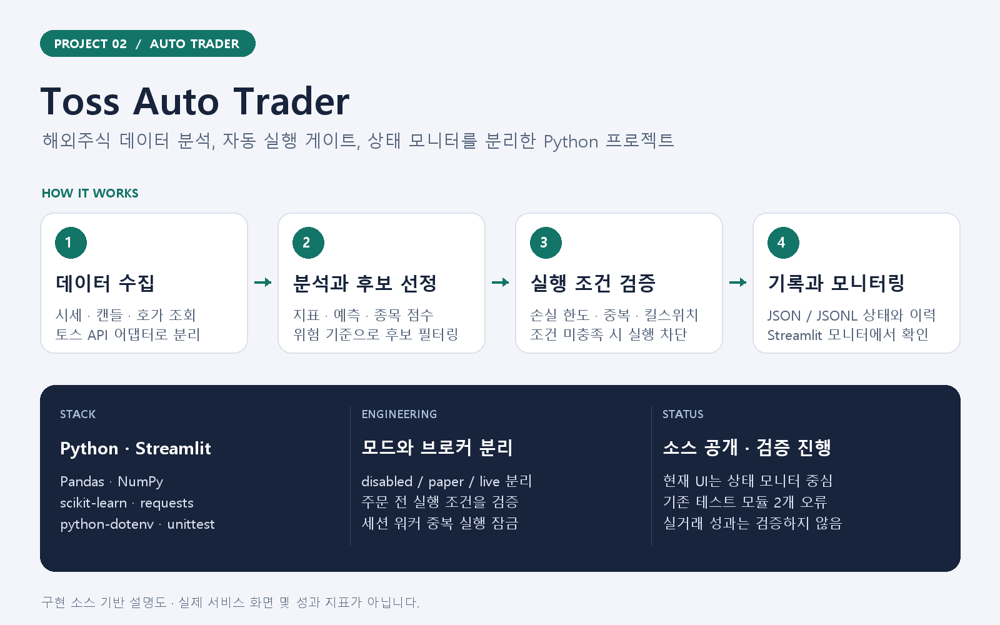
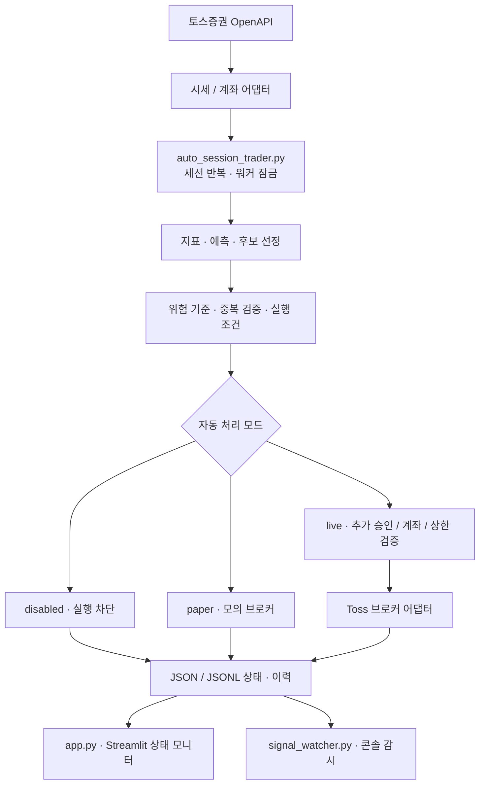

# Toss Auto Trader — 해외주식 분석·자동 실행·모니터링

토스증권 OpenAPI 연동 코드와 Python 분석 모듈을 바탕으로 **데이터 수집 → 후보 선정 → 실행 조건 검증 → 상태 기록**을 연결한 프로젝트입니다. Streamlit 모니터에서 워커·신호·매매 의도·보유 상태를 확인하도록 구성했습니다.



> 위 이미지는 소스 구조를 설명하는 자료입니다. 실제 거래 화면이나 수익률을 나타내지 않습니다.

## 개발 목적

시세를 확인하는 화면과 주문을 실행하는 로직을 분리하고, 분석 결과가 어떤 조건을 통과해야 실행되는지 추적할 수 있도록 만드는 데 목적을 두었습니다. 데이터 분석뿐 아니라 실행 차단, 중복 방지, 파일 기반 상태 전달을 함께 다룹니다.

## 현재 구현 범위

| 영역 | 소스에 포함된 기능 |
| --- | --- |
| 데이터 연동 | 시세·캔들·호가와 계좌·주문 조회/전송용 토스 API 어댑터 |
| 분석 | Pandas·NumPy 기반 지표, 계산식 예측, scikit-learn 기반 예측 코드, 후보 점수·선정 |
| 위험·실행 조건 | 손실 한도, 수익 락, 데이터 품질 가드, 중복 의도·주문 검증, 킬스위치 |
| 자동 처리 | 세션 워커, 워커 잠금, disabled / paper / live 모드 분리 |
| 모니터링 | Streamlit에서 워커 상태·최신 신호·매매 의도·자동 처리 상태·보유 현황·최근 이벤트 표시 |
| 기록·분석 도구 | JSON/JSONL 상태·이력, 신호 감시, 백테스트·리플레이·거래 복기 모듈 |

**현재 `app.py` 화면은 상태 모니터 중심입니다.** 이전 문서에 나온 모든 설정·주문·차트 UI가 현재 버전에 제공되는 것은 아닙니다. 소스 포함 여부와 실제 실행 검증 여부는 구분하며, 알려진 오류는 아래에 명시했습니다.

## 시스템 구조



도식은 논리적 처리 흐름입니다. API 이용 가능 여부·접근 권한과 실제 주문 동작은 별도 확인 대상이며, 이 문서 작성 과정에서 실주문을 실행하지 않았습니다.

## 기술 스택

| 구분 | 사용 기술 |
| --- | --- |
| 언어·화면 | Python, Streamlit |
| 데이터·분석 | Pandas, NumPy, scikit-learn |
| 외부 연동·설정 | requests, python-dotenv, 토스 API 어댑터 |
| 상태 저장 | JSON 스냅샷, JSONL 이벤트 이력 |
| 검증·운영 보조 | unittest, 세션 워커, PowerShell 보조 스크립트 |

## 설계에서 집중한 부분

- **분석과 주문 경계**: 매매 의도, 실행 계획, 브로커 어댑터를 나눠 실행 전에 차단 이유를 확인하도록 구성했습니다.
- **명시적인 실행 모드**: 비활성·모의·라이브 모드를 구분하고, 예제 설정은 라이브 주문 차단 상태로 제공합니다.
- **반복 실행의 제어**: 워커 잠금, 중복 의도·제출 확인, 종료 신호와 연속 오류 처리를 둡니다.
- **화면과 워커의 분리**: 워커가 기록한 상태를 모니터가 읽습니다. 모니터 실행 자체가 워커 시작을 의미하지 않습니다.

## 시작하기

Python 3.10 환경에서 기존 테스트를 실행했습니다.

```powershell
python -m venv .venv
.\.venv\Scripts\Activate.ps1
python -m pip install -r requirements.txt
Copy-Item .env.example .env
streamlit run app.py
```

기본 화면은 `http://localhost:8501`입니다. 상태 파일이 없으면 빈 상태로 표시됩니다. `.env`에는 본인의 API 설정을 입력하고, 라이브 주문은 비활성 상태로 유지한 채 모듈과 모의 실행부터 확인하세요.

- 화면: `app.py`
- 세션 워커: `auto_session_trader.py`
- 핵심 모듈: `stock_signal/`
- 테스트: `tests/`
- 이전 상세 사용 문서: [docs/USAGE.md](docs/USAGE.md) — 일부 내용은 현재 UI와 다릅니다.

## 검증 상태와 알려진 문제

```powershell
python -m unittest discover -s tests -q
```

2026-10-30 업로드 시 위 명령은 **153개 테스트 항목과 import 오류 2개**를 보고했습니다.

| 오류가 발생한 테스트 모듈 | 원인 |
| --- | --- |
| `test_app_persistence` | 현재 `app.py`에 없는 `atomic_write_json`을 import |
| `test_chart_helpers` | 현재 `app.py`에 없는 `dataframe_selected_rows`를 import |

전체 테스트 통과 상태가 아니며, 라이브 API 연결·실거래 성과도 검증하지 않았습니다. 이 저장소는 현재 소스와 알려진 한계를 함께 기록한 개발 스냅샷입니다. 상세 업로드 기록은 [GITHUB_BACKUP.md](GITHUB_BACKUP.md)를 참고하세요.

## 공개 범위

API 키, 계좌 설정, 보유·거래 내역, 실행 로그, 다운로드한 시세 데이터, 생성 모델과 개인 화면 캡처는 포함하지 않습니다. 실행 중 생성되는 파일은 `.gitignore`로 제외합니다.

토스 API 및 외부 라이브러리 이용에는 각 제공자의 이용 조건이 적용됩니다. 분석 결과는 수익 보장이나 투자 권유를 의미하지 않습니다.
